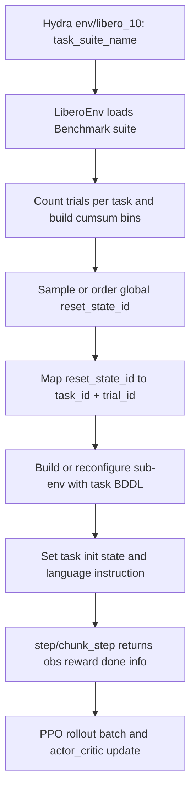
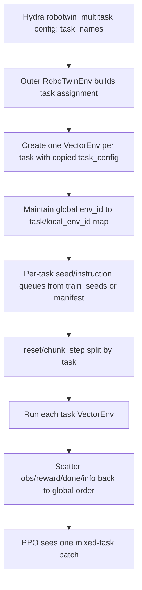

# 2026-07-11 RoboTwin 多任务 PPO 设计

## 目标与结论

目标是在 RLinf 的 RoboTwin 环境中支持一个 PPO run 内混合多个 RoboTwin task 训练。

当前结论：

- PPO runner、GAE、`actor_critic` loss 本身按 batch 工作，不限制单任务。
- 当前 `RoboTwinEnv` 是单任务 wrapper：初始化时只读取 `cfg.task_config.task_name`，并把一个 `task_config` 传给外部 `robotwin.envs.vector_env.VectorEnv`。
- 外部 RoboTwin `VectorEnv` 也是单任务实现：初始化时从 `task_config["task_name"]` 创建所有 `SubEnv`，reset 时只能换 seed/instruction，不能换 task。
- 因此 RoboTwin 多任务 PPO 的 v1 方案应在 RLinf wrapper 层实现多个单任务 `VectorEnv` 分片，而不是改外部 RoboTwin 包。

## Libero 多任务 PPO 是如何实现的

Libero 的关键抽象是把一个 task suite 下的所有 `(task, trial)` 展平成全局 `reset_state_id` 空间：

1. Hydra 配置只指定 `task_suite_name`，例如 `libero_10`。
2. `LiberoEnv` 通过 benchmark suite 读取 task 列表和每个 task 的 init states。
3. `_compute_total_num_group_envs()` 统计每个 task 的 trial 数，构造 cumulative bins。
4. 每次 reset 采样或顺序取一个全局 `reset_state_id`。
5. `_get_task_and_trial_ids_from_reset_state_ids()` 把全局 id 映射成 `(task_id, trial_id)`。
6. `_reconfigure()` 发现 task 变化时，用新的 BDDL 参数重建对应子环境，并设置对应 init state。
7. PPO 只看到一个混合后的 rollout batch，不需要感知 task 切换细节。

Libero 流程图：



Libero 中需要参考的代码点：

- `rlinf/envs/libero/libero_env.py`
  - `task_suite_name` 加载 benchmark suite。
  - `_compute_total_num_group_envs()` 统计 task/trial 空间。
  - `_get_task_and_trial_ids_from_reset_state_ids()` 做全局 id 到 task/trial 的映射。
  - `_reconfigure()` 在 task 变化时重建对应子环境。
- `rlinf/envs/libero/venv.py`
  - `ReconfigureSubprocEnv` 支持对子环境发送 `reconfigure` 命令。

## RoboTwin 当前路径和限制

当前 RoboTwin 单任务路径：

```mermaid
flowchart TD
  A[Hydra env/robotwin_xxx] --> B[RoboTwinEnv reads cfg.task_config.task_name]
  B --> C[Load seeds_path and select data[task_name]]
  C --> D[Build reset_state_ids and optional instructions]
  D --> E[Create one external VectorEnv with one task_config]
  E --> F[VectorEnv creates all SubEnv with same task_name]
  F --> G[chunk_step returns single-task rollout]
  G --> H[PPO update]
```

限制：

- `RoboTwinEnv.task_name` 是单个字符串。
- `seeds_path` 虽然可以包含多个 task key，但当前只取 `data[self.task_name]`。
- episode log 里的 `task` 固定为 `self.task_name`。
- 外部 `VectorEnv` 在初始化时把 `task_config["task_name"]` 固定到所有 `SubEnv`。
- 外部 `VectorEnv` 会原地修改 `task_config`，所以多任务时必须 deep copy 每个 task 的 config。

## RoboTwin 多任务 PPO v1 设计

v1 不改 PPO、不改外部 RoboTwin 包，只扩展 RLinf 的 `RoboTwinEnv`。

目标流程图：



### Config 接口

保持单任务配置完全兼容。新增字段只在多任务配置中使用：

```yaml
env:
  train:
    env_type: robotwin
    task_names:
      - beat_block_hammer
      - place_a2b_left
      - place_a2b_right
    task_config:
      task_name: beat_block_hammer  # 兼容旧路径；多任务时会被 task_names 覆盖
      ...
  eval:
    task_names:
      - beat_block_hammer
      - place_a2b_left
      - place_a2b_right
```

默认策略：

- 未设置 `task_names` 时走当前单任务逻辑。
- 设置 `task_names` 且长度大于 1 时进入多任务逻辑。
- `task_names` 使用固定 env slot 分配，默认 round-robin 到 global env ids。
- `group_size` 仍保持 RLinf 现有语义，要求 `total_num_envs` 能被 `group_size` 整除。

### RoboTwinEnv 改动点

建议新增内部状态：

- `self.task_names: list[str]`
- `self.is_multitask: bool`
- `self.env_task_names: list[str]`，长度为 `num_envs`，记录每个 global env slot 的 task。
- `self.env_local_indices: list[int]`，global env slot 到 task 内 local slot 的映射。
- `self.task_to_global_indices: dict[str, list[int]]`
- `self.venvs: dict[str, VectorEnv]`，多任务时每个 task 一个外部 `VectorEnv`。
- `self.task_success_seeds: dict[str, torch.Tensor]`
- `self.task_episode_manifests: dict[str, list[dict]]`
- `self.current_instructions: list[str] | None`，仍按 global env order 存储。

核心行为：

- `_init_env()`：
  - 单任务保持原逻辑。
  - 多任务时按 `task_to_global_indices` 为每个 task 构造独立 `VectorEnv`。
  - 对每个 task deep copy resolved `task_config`，把 `task_name` 覆盖为当前 task。
  - 传入该 task 分片的 seeds/instructions。
- `_init_reset_state_ids()`：
  - 单任务保持原逻辑。
  - 多任务时从 `seeds_path` 按每个 task key 读取 `success_seeds` 或 `episodes`。
  - 训练优先支持 `success_seeds`，每个 task 单独 partition 或 shuffle。
  - eval manifest 只在所有 task 都有 `episodes` 时启用。
- `reset(env_idx=None, env_seeds=None)`：
  - 单任务保持原逻辑。
  - 多任务时把 global `env_idx` 按 task 分组，转换成对应 task `VectorEnv` 的 local indices。
  - 每个 task 调自己的 `venv.reset(...)`，最后调用统一的 `get_obs` 或 scatter 结果。
- `chunk_step(chunk_actions)`：
  - 单任务保持原逻辑。
  - 多任务时把 `chunk_actions` 按 task 分组，传给对应 `VectorEnv`。
  - 将 obs、reward、termination、truncation、info scatter 回 global env order。
- `_record_metrics()`：
  - 继续记录 return、episode_len、seed。
  - 新增 `episode["task_id"]`，类型为 tensor。
  - 对 string task name，写 episode log 即可，不塞进 tensor metric。
- `_write_episode_records()`：
  - 多任务时每条 record 的 `"task"` 使用该 global env slot 的实际 task。

### 数据流注意点

- obs 字段必须保持与现有 rollout/model 兼容：
  - `main_images`
  - `wrist_images`
  - `states`
  - `task_descriptions`
- scatter obs 时要支持 `wrist_images is None` 的情况。
- reward、done tensor 必须保持 device 与当前实现一致。
- 多任务 batch 内的 language instruction 会随 obs 的 `task_descriptions` 进入 OpenPI/OpenVLA 侧，不需要改 PPO loss。

## 测试计划

优先加不依赖真实 RoboTwin/Sapien 的单元测试，使用 fake `VectorEnv` monkeypatch。

1. 单任务回归：
   - 未设置 `task_names` 时，`RoboTwinEnv` 仍只创建 `self.venv`。
   - `reset_state_ids` 和现有 seed 分配行为不变。
2. 多任务 assignment：
   - 给定 `task_names=[a,b,c]` 和 `num_envs=6`，global env ids round-robin 分配为 `a,b,c,a,b,c`。
   - 每个 task 的 local env 数正确。
3. 多任务 seed：
   - fake `train_seeds.json` 中每个 task 的 seed 不同。
   - 每个 global env slot 只拿自己 task 的 seed。
4. 多任务 reset：
   - reset 指定部分 global env ids 时，只调用对应 task 的 `VectorEnv.reset`。
   - local env id 转换正确。
5. 多任务 chunk_step：
   - fake `VectorEnv.step` 返回带 task 标记的 obs/reward/info。
   - scatter 后 global order 与输入 env slot 顺序一致。
6. episode log：
   - done env 的 record 写出实际 task、seed、instruction。
7. 配置 smoke：
   - 新增一个 `robotwin_multitask_ppo_openpi_pi05.yaml`，Hydra compose 通过即可，不启动真实环境。

## 后续实现顺序

1. 先在 `RoboTwinEnv` 内加兼容性的 `task_names` 解析和 env slot assignment。
2. 加 fake `VectorEnv` 单元测试，锁住 split/scatter 行为。
3. 实现多任务 seed/instruction 管理。
4. 实现多任务 `_init_env`、`reset`、`chunk_step`。
5. 加多任务 example config。
6. 做一次小规模 smoke：2 task、少量 env、只检查 env 初始化和一轮 rollout 是否能进入 PPO batch。

